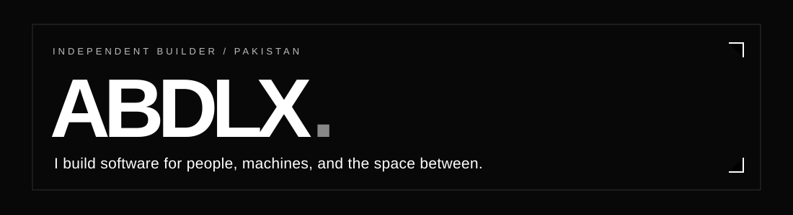
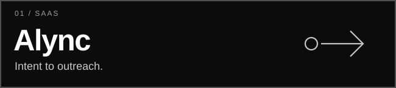
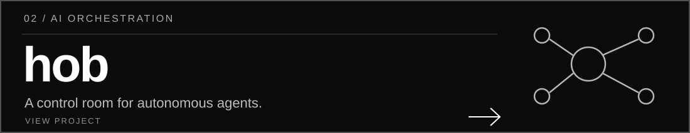
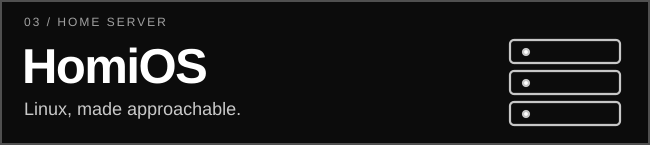
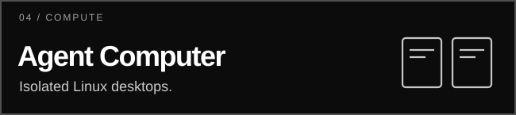
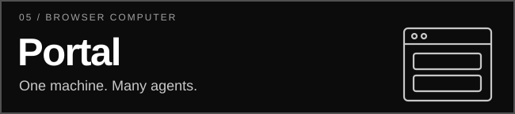

 

**Building useful things. Making complex systems feel simple.**

AI agents · self-hosted infrastructure · products · interfaces

---

### Selected work

  

<table>
  <tr>
    <td width="50%">
      
    </td>
    <td width="50%">
      
    </td>
  </tr>
  <tr>
    <td width="50%">
      
    </td>
    <td width="50%">
      
    </td>
  </tr>
</table>

---

DESIGNED & BUILT BY <a href="https://github.com/abdlx">ABDLX</a> · KARACHI, PAKISTAN

